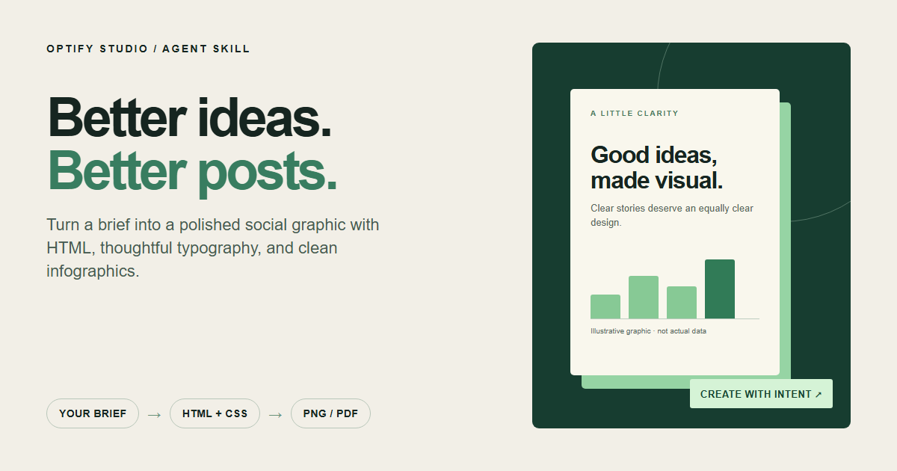

# Social Media Post Skill

[](https://agentskills.io/)
[](#what-it-does)
[](#what-it-does)
[](https://github.com/Optify-Studio/social-media-post-skill/stargazers)



An agent skill for creating custom social media posts and infographics with editable HTML and CSS, then exporting PNG or PDF. It works from a project, supplied assets, or a standalone creative brief. The skill instructs your agent to ask about the audience, content, style, brand, platform, dimensions, and output before designing.

## What it does

- Creates single graphics or carousel slides using HTML, CSS, and optional SVG.
- Adapts layouts, typography, and infographics to your brief and brand.
- Supports platform-oriented presets or custom dimensions, PNG, PDF, or both.
- Calls for research or supplied sources for factual claims, accessible contrast and labels, and inspection of the rendered result.
- Keeps editable HTML alongside exports unless you request otherwise.

The skill is a set of instructions for an agent, not a standalone graphic-design application. Results depend on the agent's capabilities, available assets, browser, and ability to inspect output. Platform requirements change; verify current specifications for your intended placement.

## Install with npx

The [skills CLI](https://github.com/vercel-labs/skills) supports OpenCode, Claude Code, Codex, Cursor, Gemini CLI, GitHub Copilot, and many others. It currently requires Node.js 22.20 or newer. `npx` may download the CLI; review its source and permissions before use.

### Install from GitHub

From any project, install the skill for your choice of agents:

```bash
npx skills add Optify-Studio/social-media-post-skill --skill social-media-post
```

Choose your agents when prompted. Add `-g` to install across projects. The CLI installs the skill and bundled renderer; it does **not** install the renderer's Playwright dependency. You may need to restart your agent for it to discover the skill.

### Prefer a prompt instead of a command?

Paste this into your favorite coding agent:

> Install the `social-media-post` skill from https://github.com/Optify-Studio/social-media-post-skill for this project and make it available to your agent. Review its instructions first. Ask me before installing any additional dependencies or changing global configuration. Then use the skill to help me create a social media post, starting by asking about my content, platform, style, size, branding, and preferred PNG or PDF output.

The agent needs permission and tools to access GitHub and install skills. Tell it if you want a global installation instead; exact discovery and installation steps depend on the agent.

## Use

Ask your agent, for example:

> Use the social-media-post skill to create a three-slide Instagram carousel explaining composting. Ask me about style, dimensions, branding and export format before you start.

Or provide your brand assets, exact copy, chart data, sources, dimensions, and output preference up front. The agent should skip already-answered questions and may suggest defaults if you ask it to decide. It should not publish posts without your permission.
